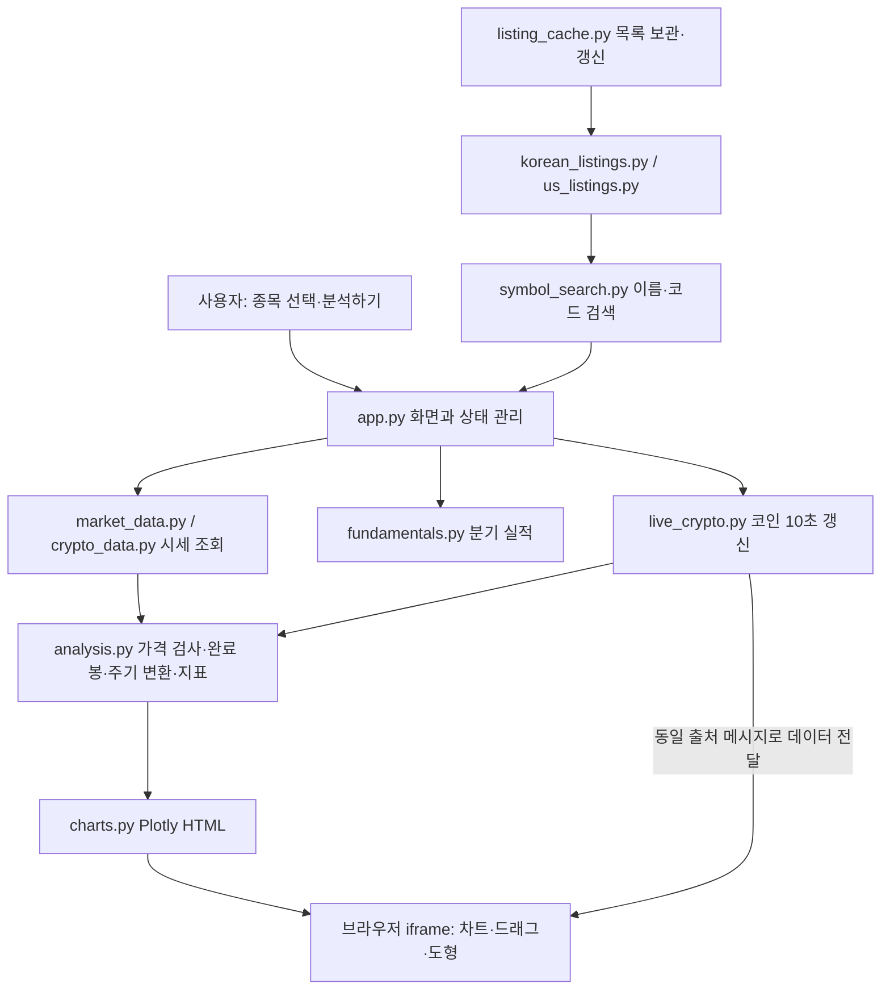

# 차트 분석 프로그램 인수인계 문서

작성 기준: 2026-11-05. 다음 개발자 또는 구독 재개 후 AI에게 이 문서와 `SOURCE_GUIDE.md`를 먼저 읽혀 주세요.

## 1. 프로젝트를 다시 찾는 방법

- GitHub: https://github.com/wagurano87/chart-analysis
- 배포 주소: https://scrooge-analysis.streamlit.app/
- 기본 브랜치: `main`
- 실행 시작 파일: `app.py`
- 권장 Python: 3.12. 실제 라이브러리 버전은 `requirements.txt`가 기준입니다.
- 이 문서 직전 기능 커밋: `2998490` — 코인 10초 자동 갱신.
- 이 문서 직전 보안 커밋: `eade8eb` — iframe 메시지 출처 제한 및 내부 오류 노출 완화.
- **ChatGPT/Codex 구독과 GitHub 저장소·Streamlit 호스팅은 별도 서비스입니다.** 구독 종료 자체가 저장소 삭제를 뜻하지 않습니다. 다만 계정·호스팅 정책·절전·제공처 제한에 따라 서비스 상태가 달라질 수 있으므로 코드 사본도 보관하세요.
- 이 문서는 `chart-analysis` 프로젝트 기준입니다. 예전에 만든 WEBSCRAP PDF 도구는 다른 프로젝트이며 이 저장소에 포함되지 않습니다.

## 2. 무엇을 하는 프로그램인가

한국·미국 주식과 바이낸스·업비트 현물의 가격·거래량을 받아 차트와 수학적 지표를 표시하는 웹앱입니다. **프로그램 실행에는 LLM·ChatGPT API가 사용되지 않습니다.** 개발 과정에서 AI를 사용했지만, 실제 분석은 Python 계산식으로 수행합니다.

| 기능 | 현재 동작 |
|---|---|
| 종목 입력 | 이름·코드·티커를 한 입력칸에서 검색하고 선택하면 시장·코드를 자동 반영 |
| 한국 종목 목록 | KIND 코스피·코스닥·코넥스 상장사 목록. 일부 기본 한글·영문 별칭도 제공 |
| 미국 종목 목록 | Nasdaq Trader 미국 거래소 목록. 영문명·티커 및 일부 등록된 한글 별칭 |
| 목록 갱신 | 앱 이용 중 24시간 기준 갱신. 실패 시 기존 목록 유지, 1시간 뒤 재시도. 상태는 도움말로 표시 |
| 빠른 선택 | 바이낸스 BTCUSDT·ETHUSDT 버튼 |
| 데이터 방식 | 온라인 시세, OHLCV CSV 업로드, 실제 시세가 아닌 가상 데이터 체험 |
| 봉 주기 | 일봉·주봉·4시간봉. 4시간봉은 온라인 시세에서만 지원 |
| 가격·거래량 | 캔들, 거래량, 직전 20봉 평균 거래량, 현재 표시 범위 VRVP 추정 |
| 이동평균 | 단순 이동평균 10·20·60·120·200·365봉 |
| 보조지표 | MACD(6,19,9), MACD(19,39,9), RSI(14), OBV, +DI·−DI·ADX·ADXR |
| 지표 설정 | DI/ADX/ADXR 기간 기본 14, ADX 기준선 기본 20 |
| 차트 조작 | 이동, 시간축 휠 확대, 세로축 휠·드래그 확대, Shift+휠 좌우 이동, 세로 맞춤 |
| 보기 범위 | 최근 60봉·180봉·전체, 기본 보기, MA 표시 전환, PNG 저장 |
| 그리기 | 추세선, 사각형, 가격·기간 측정, 피보나치 되돌림 |
| 삭제 | 선택 후 Delete, 선택 삭제, 도형 목록 선택, 사용자 도형 전체 삭제 |
| 모바일 | 두 손가락 확대·축소, 한 손가락 페이지 스크롤, 도형 선택·삭제 버튼 |
| 실적 | 기업의 최근 제공된 최대 8분기 매출·영업이익·영업이익률, 최신 단일 PEG. 한 줄에 2개 그래프 |
| 내보내기 | 분석 데이터 CSV, 차트 PNG |

TradingView처럼 조작하도록 개선했지만 **TradingView 엔진을 내장한 프로그램은 아닙니다.** Plotly로 만든 자체 차트이며 하단 TradingView 외부 차트는 제거했습니다. 최고·최저 요약 카드와 표시 범위·POC 텍스트도 요청에 따라 제거했습니다. VRVP와 POC 막대 자체는 남아 있습니다.

## 3. 시그널 규칙 — 임의로 바꾸지 말 것

### 초록색 ▲: DI 매수 시그널

- 직전 봉의 `+DI ≤ −DI`이고 현재 완료 봉의 `+DI > −DI`인 상향 돌파.
- 가격 차트 저가 위치와 DI 패널에 표시.
- +DI가 계속 위에 있는 봉마다 반복 표시하지 않음.
- ADX가 20 이상이어야 한다는 추가 조건은 **없음**.

### 분홍색 ▼: MACD 매도 주의 시그널

- MACD(19,39,9)가 0을 상향 돌파한 이력을 데이터 안에서 관찰해야 조건 활성화.
- MACD가 양수를 유지하는 동안 히스토그램(MACD−시그널선)이 0 이상에서 음수로 바뀐 봉에 표시.
- MACD가 0 이하가 되면 초기화. 히스토그램 음수가 계속되면 반복 표시하지 않음.
- 양수 MACD 구간에서 히스토그램이 회복했다가 다시 음전환하면 다시 표시 가능.

화면의 '매도 검토 경고'는 별도 요약입니다. MACD 하락·데드크로스·0선 하향 돌파와 거래량을 조합합니다. 거래량 배율은 **현재 봉을 제외한 직전 20봉 평균**으로 계산합니다. 이 신호는 수익성을 검증한 자동 투자 전략이 아니며 주문을 내지 않습니다.

## 4. 전체 실행 흐름



1. 브라우저에서 접속하면 Streamlit 서버가 `app.py`를 실행합니다.
2. 검색 목록은 공개 제공처에서 받아 캐시에 저장합니다. 주가 데이터와 검색 목록은 별개입니다.
3. 분석하기를 누르면 시세를 받거나 CSV·가상 데이터를 읽습니다.
4. 잘못된 가격 데이터를 검사하고 완료된 봉을 선택합니다. 선택 주기로 바꾼 뒤 지표를 계산합니다.
5. 가격 표에 지표 열을 추가한 결과를 `charts.py`가 HTML+JavaScript 차트로 만듭니다.
6. 브라우저가 차트를 그리며 스크롤·드래그·도형 계산은 주로 브라우저에서 처리합니다.
7. 코인 자동 갱신은 아래 별도 경로로 기존 차트 데이터만 갱신합니다.

## 5. 코인 10초 갱신의 핵심 구조

- 대상: 온라인 바이낸스·업비트, 일봉·주봉·4시간봉. 기본 켜짐, 스위치로 끌 수 있음.
- Streamlit `fragment(run_every='10s')`가 최근 30개 일봉 또는 4시간봉을 조회합니다. 주봉은 일봉에서 합산합니다.
- 같은 시작 시각의 봉은 교체하고 새 봉은 붙입니다. 과거 전체 데이터를 매번 거래소에서 다시 받지 않습니다.
- 지표는 이력을 포함해 다시 계산합니다. 진행 중인 봉도 그리지만 시그널 열은 마감 전 False입니다.
- 작은 전달용 iframe이 JSON 데이터를 같은 사이트의 차트 iframe으로 보냅니다. 수신 출처와 매번 만든 차트 식별값을 확인합니다.
- `Plotly.react`로 그래프 데이터를 교체하면서 축 범위·도형·MA 표시 상태를 유지합니다. 페이지 전체를 10초마다 재실행하지 않습니다.
- 최신 구간을 보고 있다면 새 봉이 생길 때 따라가고, 과거를 보고 있다면 사용자의 범위를 유지합니다.
- 실패하면 마지막 차트를 유지하고 실패 상태를 보여줍니다. 오래 접속을 중단해 이력에 큰 공백이 생기면 분석하기로 다시 조회합니다.
- **차트 밖 요약·신호 내역·CSV는 분석하기를 누른 시점 기준**입니다. 자동 갱신 차트와 다를 수 있습니다.
- 별도 주문·실시간 푸시 서버는 없습니다. 사용자가 많아지면 세션별 요청을 공유하는 구조가 필요합니다.

## 6. 상태와 저장 위치

| 위치 | 저장되는 것 | 유지 범위 |
|---|---|---|
| GitHub `main` | 소스·설정 예시·문서·테스트 | 커밋으로 보관 |
| `.venv/` | 로컬 Python 라이브러리 | 해당 PC/개발환경, Git 제외 |
| `.cache/korean_listings.json` | 마지막 성공 국내 목록 | 서버 로컬 디스크, 재배포 시 삭제될 수 있음 |
| `.cache/us_listings.json` | 마지막 성공 미국 목록 | 위와 동일 |
| Streamlit `session_state` | 선택 종목·분석 결과·갱신 이력 | 현재 사용자 세션 |
| Streamlit 데이터 캐시 | 시세 15분, 시간봉 5분, 재무 6시간 | 서버 캐시; 코인 자동 갱신은 별도 최근 시세 요청 |
| 브라우저 차트 | 그린 도형·확대 위치 | 차트 유지 중. 새로고침·종목/주기 변경 등 재생성 시 소실 가능 |
| 다운로드 폴더 | 사용자가 저장한 CSV·PNG | 사용자 PC |

영구 사용자 DB, 도형 저장 서비스, 계좌 정보 저장소는 없습니다. 원본 업로드 CSV를 별도 파일로 저장하지는 않지만 서버 메모리에서 처리합니다.

## 7. 로컬 실행과 웹 배포

### Windows PowerShell

Git과 Python 3.12를 설치한 후:

```powershell
git clone https://github.com/wagurano87/chart-analysis.git
cd chart-analysis
.\install.ps1
.\start.ps1
```

이미 내려받았다면 먼저 `git status`로 로컬 수정 여부를 확인한 뒤 `git pull --ff-only`로 업데이트합니다. 설치 파일이 바뀌면 `install.ps1`을 다시 실행합니다. PowerShell 실행 정책으로 막힌다면 임의로 시스템 전체 보안을 해제하지 말고 Python을 직접 실행할 수 있습니다:

```powershell
py -3.12 -m venv .venv
.\.venv\Scripts\python.exe -m pip install -r requirements.txt
.\.venv\Scripts\python.exe -m streamlit run app.py --server.address 127.0.0.1
```

### Linux / 클라우드 개발

```bash
python3.12 -m venv .venv
.venv/bin/python -m pip install -r requirements.txt
.venv/bin/python -m streamlit run app.py
.venv/bin/python -m unittest discover -s tests -q
```

### 배포

Streamlit Community Cloud에서 저장소 `wagurano87/chart-analysis`, 브랜치 `main`, 진입 파일 `app.py`, Python 3.12를 사용합니다. 자세한 절차는 `DEPLOYMENT.md`를 참고하세요. `git push` 성공과 웹앱의 정상 반영은 별개이므로 로그와 사이트에서 최종 확인해야 합니다.

ChatGPT 구독 없이도 GitHub의 **Code → Download ZIP**으로 코드를 보관할 수 있습니다. 문서 파일도 함께 내려받으세요. 다른 사람에게 계정 비밀번호나 토큰을 전달할 필요는 없습니다.

## 8. 알려진 제한과 남은 과제

**가장 먼저 확인할 항목: 국내 목록 다운로드.** 사용자가 보여준 배포 화면에서 국내 목록은 연결 실패, 미국 목록은 13,081개 수신 성공으로 표시되었습니다. 국내 전체 목록이 정상 작동한다고 단정하면 안 됩니다. 이후 메시지를 도움말로 옮겼지만 연결 문제가 해결되었다는 뜻은 아닙니다. 국내 실패 원인·KIND 응답 형식·대체 공식 소스 검토가 후속 과제입니다.

- 개발 환경의 네트워크 정책 때문에 거래소·Yahoo·KRX 등에 대한 실제 요청 검증이 제한되었습니다.
- 국내 목록은 상장사 중심이며 모든 ETF·ETN·우선주를 포괄하지 않습니다. 코넥스 종목은 목록에 있어도 현재 Yahoo 시세 어댑터에서 조회가 안 될 수 있습니다.
- 미국 전체 회사명의 한글 번역을 제공하지 않습니다. 등록되지 않은 회사는 영문명·티커로 검색해야 합니다.
- 주식 시세는 실시간 보장이 없습니다. 실시간 주식 API는 아직 미구현입니다.
- 주식 마감·주봉 완료 판단은 보수적인 시간 기준이며 휴일·반일장 달력을 완전히 반영하지 않습니다.
- 주식 4시간봉은 1시간봉을 정규장 기준으로 묶으며 당일 봉은 마감 확인 이후 사용합니다.
- 지표 계산에는 최소 120봉이 필요합니다. MA365 등은 데이터가 충분해질 때부터 표시됩니다.
- 분기 실적은 최대 8분기 요청 취지이나 Yahoo에서 그보다 적게 줄 수 있습니다. PEG는 8분기 시계열이 아닌 최신 값입니다.
- VRVP는 봉의 저가~고가에 거래량을 분배한 추정치입니다. 거래소의 실제 체결가별 거래량과 다릅니다.
- 시그널의 전략 수익성, TradingView 사용자 지표 원본과의 완전한 수치 일치는 검증하지 않았습니다.
- 실제 iPhone Safari와 배포 서버의 모든 동작을 직접 검증한 것은 아닙니다.
- 코인 갱신은 개인·소규모 이용 구조입니다. 여러 사용자를 위한 시세 공유, 부하 제한, 모니터링은 후속 과제입니다.
- Windows Codex 사용량 표시 도구는 대화에서 논의됐지만 이 저장소에 구현되어 있지 않습니다.

## 9. 보안과 검증 기록

- 계좌 API 키·자동 주문·LLM API 없이 공개 데이터만 조회합니다.
- 공개 앱에는 자체 로그인 제한이 없습니다. 비공개 이용은 호스팅 접근 설정으로 관리해야 합니다.
- CSV는 서버로 전송되므로 개인정보·계좌정보를 넣지 마세요.
- 비밀정보는 Git에 커밋하지 마세요. `.env`, `.streamlit/secrets.toml` 등은 Git 제외 대상입니다.
- 실시간 메시지는 동일 출처·차트 식별값 확인, JSON HTML 이스케이프, 내부 오류 안내 축소를 적용했습니다.
- 자동 갱신 구현 시 전체 77개 단위·앱 테스트 통과. 보안 변경 후 관련 4개 및 로컬 Streamlit 연속 갱신 검증 통과.
- 브라우저에서 확대 위치·도형 보존, 피보나치·삭제·축 조작·내부 스크롤 제거를 검증했습니다. 자세한 범위는 `REVIEW.md`, `SECURITY_REVIEW.md`를 확인하세요.
- 과거 전체 Git 이력의 비밀정보 감사, 패키지 취약점 DB 대조, 배포 서버 침투 테스트는 수행하지 않았습니다.

## 10. 다음에 AI에게 붙여 넣을 요청문

> GitHub `wagurano87/chart-analysis` 프로젝트를 이어서 개발하려고 합니다. 먼저 HANDOFF.md, SOURCE_GUIDE.md, REVIEW.md, SECURITY_REVIEW.md를 읽고 실제 코드와 최신 main 상태를 확인하세요. 배포 앱은 https://scrooge-analysis.streamlit.app/ 입니다. Python 3.12·Streamlit·Plotly 기반이며 LLM을 사용하지 않습니다. 한국/미국 주식과 바이낸스/업비트, 일봉/주봉/4시간봉을 지원합니다. 코인 10초 갱신 시 확대 위치와 도형을 유지해야 하며 매수/매도 시그널은 완료 봉에서만 확정해야 합니다. +DI 상향 돌파 매수에는 ADX 추가 조건이 없습니다. 국내 전체 목록의 실제 배포 연결 실패는 해결 여부를 다시 확인해야 합니다. 기존 변경을 보존하고, 필요한 수정과 검증을 완료한 뒤 GitHub 반영 상태와 실제 배포 확인 여부를 구분해서 알려 주세요. 다음으로 할 작업은: [여기에 요청 작성]

작업을 맡기기 전에 위 문서의 작성 시점 이후 커밋이 있는지도 확인하세요. AI가 예전 대화를 기억한다고 가정하지 말고 이 문서와 저장소를 기준으로 이어가는 것이 안전합니다.
